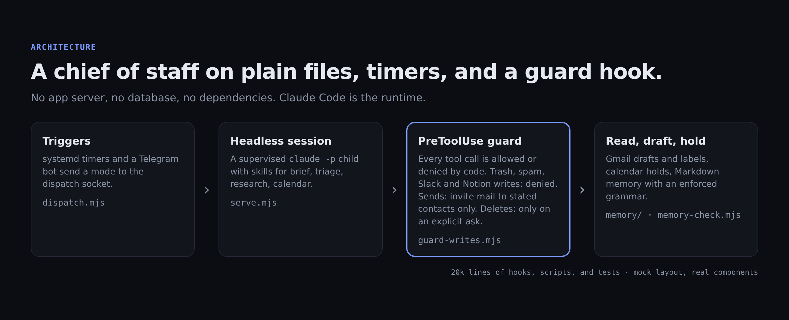

# Glissa

A personal chief of staff built on Claude Code, whose write policy lives in a PreToolUse hook because inbound mail is untrusted text that can pose as an instruction. It reads mail, calendar, and the web, drafts and holds, and never sends on its own. This Node ESM runtime has zero npm dependencies. `npm test` checks the runtime and guard contracts, including tracked-source portability.



Screenshots and launch posts with invented data live in [showcase/](showcase/posts.md); `node showcase/render.mjs` rebuilds the images from `showcase/mocks/`.

## Requirements

Use Node 22+ and npm, a logged-in Claude Code CLI, and the official `telegram@claude-plugins-official` channel plugin. Service installation needs Linux with a systemd session, and deploy needs git and tar. Google accounts need `gog` and a Google OAuth client JSON file. Buffer is optional and needs `mcp-remote` with `--header-file` support. The browser MCP needs Playwright and a private browser profile (see Browser).

## Install

From a checkout, pack and install the package, then onboard:

```sh
npm pack
npm install -g ./glissa-0.0.0.tgz
glissa init
```

For deployment from a checkout before the CLI is installed, run `node bin/glissa.mjs init`, then `node bin/glissa.mjs deploy`. Checkout init leaves service installation to deploy. Deploy requires an existing config because it installs units immediately, so it cannot complete before init on a fresh machine.

## Local configuration

`glissa init` asks for the operator's name, pronouns, form of address, home time zone, `alias=email` Google accounts (or none), optional modules and their fields, a Google OAuth client secret file when accounts are selected, and a Telegram bot token from @BotFather. Google setup uses browserless authorization, asks for a keyring password when needed, assigns the chosen aliases, and verifies Gmail reads. It creates `~/.config/glissa/gog.env` privately and repairs permissions broader than mode 600 before loading it.

Telegram pairing prints a one-time code to send to the bot from the operator's own account. Init writes the token to `~/.claude/channels/telegram/.env` and the paired sender allowlist to `access.json` beside it, both mode 600. It refuses pairing while `bot.pid` names a live process. It seeds missing `memory/profile/` templates, writes a state-directory `first-start` marker for the supervisor's hello, checks config, the Claude CLI version, and Telegram connectivity, then installs services when running from an installed package. Service installation enables and restarts the timers, supervisor, and result server.

Config is `~/.config/glissa/config.json` (mode 600), or `$GLISSA_CONFIG_DIR/config.json`, with `$XDG_CONFIG_HOME/glissa` as the config-directory default when set. [config.example.json](config.example.json) shows its fields. `glissa init --reconfigure` updates an existing config and repeats pairing; `--skip-google` skips Google setup. `glissa init --answers <file.json>` accepts config fields plus `botToken` and, for Google setup, `clientSecretFile`; Google authorization still requires a terminal.

Data lives in `${XDG_DATA_HOME:-~/.local/share}/glissa`, overridable with `GLISSA_DATA_DIR`. It includes `memory/`, `context/`, `briefs/`, `content/`, `tasks.json`, `calendar-allow.json`, `browse-domains.json`, and `logs/glissa.jsonl`. The draft voice profile is `memory/voice.md`. A legacy checkout containing `memory/` keeps resolving as the data directory even after migration, because migrate leaves originals in place, so init and deploy run from it write there (deploy tarballs land in `<checkout>/releases/`); after `glissa migrate --from <checkout> --verify` passes, move the checkout's old data aside or set `GLISSA_DATA_DIR` before running init or deploy from it. State defaults to `${XDG_STATE_HOME:-~/.local/state}/glissa` (`GLISSA_STATE_DIR` overrides it), and the dispatch socket lives under `$XDG_RUNTIME_DIR/glissa` (`GLISSA_RUNTIME_DIR` overrides it).

Init does not create `~/.config/glissa/local.env`. Every service unit loads it when present; keep it mode 600:

- `GLISSA_RESULT_HOST`: tailnet host in result links, required by `serve-results.mjs url`.
- `GLISSA_RESULT_PORT`: optional port in result links.
- `GLISSA_RESULT_LOGIN`: the tailnet login allowed to read results.
- `GLISSA_RESULT_SELF_ADDRESSES`: comma-separated addresses of this machine, refused as origins.
- `GLISSA_HOME_TIME_ZONE`: scheduling fallback when no stated profile zone applies, default UTC. Scheduling still reads this environment key rather than `config.homeTimeZone`.
- `GLISSA_ASSET_BASE_URL`: allowed Buffer asset URL prefix (see Browser).

Keep `--gmail-scope readonly` on every `gog auth add`, including reauthorization: broader Gmail scopes cannot be taken back by the guard. Calendar is authorized read-write, with writes restricted by `hooks/guard-writes-core.mjs`.

## Optional modules

Set `modules` in config through init. The default is `[]`:

- `content`: content planning and Buffer drafts, with no additional config object. Requires Buffer setup below.
- `changelog`: requires `content` and `changelog.productName`, `changelog.productDescription`, and `changelog.changelogFile`. `changelog.capturesDirectory` is optional. Enables the changelog module's hourly timer.
- `digest`: requires `digest.newsletterSender` and `digest.workContext` for newsletter selection and ranking.

Run `glissa install-units` after changing module settings to reconcile timers. The morning brief (07:10), evening recap (20:10), mail watch, task reminder, and the changelog module's hourly timer send modes through the owner-only dispatch socket. Changelog dispatch starts a session only for an uncovered release without an update post already planned for today or later. The health timer checks delivery outcomes every 10 minutes.

The housekeep timer runs daily at 03:20, expires dated profile facts into `memory/archive/`, checks and snapshots memory, then prunes done task records after 30 days. Exit 5 means no work and counts as success; other failures alert. Pruned task records have no git backup.

## Deploy and development

Run `glissa deploy [<ref>]` from a checkout to archive and pack a commit (default `main`), install it globally, and reinstall units. It retains the newest five tarballs in the data directory's `releases/`. Roll back with `glissa deploy --tarball <data-directory>/releases/<older>.tgz` from a checkout; this reinstalls units and restarts services too.

`glissa run --dev` runs a second bot with data in `${XDG_DATA_HOME:-~/.local/share}/glissa-dev` by default. It needs a separate bot's token in `~/.claude/channels/telegram-dev/.env` (`GLISSA_DEV_TELEGRAM_DIR` overrides the directory) and refuses the live channel directory, live token, or a copied live poller's `bot.pid`. `GLISSA_DATA_DIR`, `GLISSA_STATE_DIR`, and `GLISSA_RUNTIME_DIR` can override the scratch paths. It uses the same config unless `GLISSA_CONFIG_DIR` is overridden.

For an old checkout-based install, stop its service before migrating, and migrate before init seeds destination files:

```sh
node bin/glissa.mjs migrate --from /path/to/old-checkout --dry-run
node bin/glissa.mjs migrate --from /path/to/old-checkout
```

`glissa migrate --from <checkout> [--to <data-directory>] [--dry-run | --verify]` copies the known data paths, verifies file hashes and links, refuses existing destination paths or escaping symlinks, and leaves originals intact; `--verify` compares an earlier copy against the originals without writing, and like migrate refuses while glissa.service runs, so run it before the service's first start, since the running service changes the data directory. It does not move credentials or config. Run init and deploy afterward; migration rollback is reinstalling the old units.

## Tasks

The task ledger policy lives in [prompts/runtime.md](prompts/runtime.md#tasks). The CLI:

```
node scripts/tasks.mjs add --stdin < task.json
node scripts/tasks.mjs list
node scripts/tasks.mjs done ab12
node scripts/tasks.mjs done --stdin < done.json
node scripts/tasks.mjs snooze ab12 +1d
node scripts/tasks.mjs due --json
node scripts/tasks.mjs mark ab12
node scripts/tasks.mjs prune
```

The [tasks skill](.claude/skills/tasks/SKILL.md#capture) carries the capture rules.

`due` only reports; `mark` is what records that a reminder reached the operator, so a failed send stays due. `mark` skips ids it cannot mark and still records the rest, failing only when it marked nothing. `due` exits 0 when tasks are due, 5 when none are, and 255 when the ledger cannot be read, and `scripts/dispatch.mjs` reads that same ledger itself, exiting 0 without contacting the dispatch socket when nothing is due and failing with exit 1 when the ledger cannot be read, which fires `glissa-alert@tasks.service`. The task timer checks for due reminders every 5 minutes. A brief that could not be delivered sends a Telegram alert.

The mail watch runs silently every 15 minutes at `*:4/15`; its cursors live in `context/watch-state.json` through `scripts/watch.mjs`, and the Google credentials it needs come from `~/.config/glissa/gog.env`, never in the repo. `scripts/gog-mcp.sh` reads that file, sourcing it and exec-ing `gog`, so the keyring password never lives in the session environment where every Bash and node child could read it. `.claude/settings.json` denies `Bash(scripts/gog-mcp.sh:*)`, `Bash(scripts/setup-mail-watch.sh:*)`, and `Read(~/.config/glissa/**)`, and its `Bash` matcher sends every Bash command through `hooks/guard-writes.mjs`, which reads a `gog` command word by word instead of refusing the binary outright. A Bash command that reads the env file some other way stays a residual the operator accepts, because the guard reads the command it is handed and never what a program that command starts goes on to run.

The write policy lives in [prompts/runtime.md](prompts/runtime.md#write-policy), enforced by `hooks/guard-writes.mjs` and pinned by `hooks/guard-writes.test.mjs`.

## Travel

`~/.config/glissa/travel.env` holds `SERPAPI_API_KEY`, `ORS_API_KEY`, `AEROAPI_API_KEY`, and optional `TFL_APP_KEY` at mode 600. `scripts/travel.mjs` alone reads it and refuses a group- or world-readable file, so credentials never enter command arguments or the session environment. The free tiers are SerpApi at 250 searches a month, OpenRouteService at 2,000 directions a day, FlightAware AeroAPI's Personal tier at up to $5 of free usage a month, and keyless TfL at 50 requests a minute.

The 200-search monthly SerpApi guard leaves capacity for manual use and records its state in `travel-quota.json` under `$GLISSA_STATE_DIR`, else `${XDG_STATE_HOME:-~/.local/state}/glissa`, so every worktree counts against the one account-wide quota. `GLISSA_TRAVEL_ENV_FILE` and `GLISSA_TRAVEL_QUOTA_FILE` override the credential and counter paths when isolation is needed. Node 22 or newer is required. The `travel-search` skill maps exit codes to handling instructions.

## Browser

`scripts/buffer-mcp.sh` bridges the official Buffer MCP at `https://mcp.buffer.com/mcp` through `mcp-remote --header-file`, so the API key stays out of process arguments and the session environment. Install `mcp-remote` with `--header-file` support, then write `Authorization: Bearer <key from publish.buffer.com/settings/api>` to `~/.config/glissa/buffer-headers.txt` at mode 600. The key can publish, so the guard allows only Buffer's read tools and a `create_post` with `saveToDraft` true, mode `customScheduled` or none, no `draftId` or `ideaId`, and every asset URL under `GLISSA_ASSET_BASE_URL` (a Tailscale Funnel on port 10000 serving `content/assets/` under a random path, set once with `tailscale funnel --bg --https=10000 --set-path /<random> "${GLISSA_DATA_DIR:-${XDG_DATA_HOME:-$HOME/.local/share}/glissa}/content/assets"` and recorded in `local.env`), `.claude/settings.json` denies the launcher to the session's Bash, and the guard refuses any Bash command that runs the launcher or names `buffer-headers`, `api.buffer.com`, or `mcp.buffer.com`. An `edit_post` changes content only for a draft `hooks/record-buffer-draft.mjs` recorded Glissa saving, read live through `hooks/buffer-post-state.mjs` as still a draft unchanged since, because the operator's own edits must never be overwritten; any other draft or scheduled post may only move, in a turn the operator started, carrying its live text, thread, and assets unchanged to a `dueAt` at least 15 minutes out and at the plan slot of the post linking it, and the record hook never adopts such a move as Glissa's draft. A Bash command that reaches the key file or that record some other way stays a residual the operator accepts, because the guard reads the command it is handed and never what a program that command starts goes on to run.

`scripts/browser-mcp.sh` launches `@playwright/mcp` headless as the `browser` MCP server. Setup once: `npm install -g @playwright/mcp@0.0.81`, then `playwright-mcp install-browser chromium` (or `npx playwright@1.64 install chromium`), then `install -d -m 700 ~/.config/glissa/browser-profile`. The launcher refuses to start when that profile directory is missing, is readable beyond the owner, or when `playwright-mcp` is off the unit's short PATH, because a binary missing from PATH has silently killed a component here before.

Logins live in that profile and nowhere else. To sign in to a site, run `playwright open --browser chromium --user-data-dir ~/.config/glissa/browser-profile <url>` on a desktop session while the service is stopped, sign in by hand, and close it; the headless server reuses the cookies. No credential is ever passed to the model, and the cookie and storage tool groups are not enabled, so no browser tool hands the jar back. The jar is still readable: it holds live session cookies, and while `.claude/settings.json` denies `Read(~/.config/glissa/**)`, the guard only matches `mcp__.*` and covers neither Bash nor any shell it spawns. The containment is that page text is never an instruction and the write policy forbids sending anything outward, not that the cookies are out of reach.

Copy `browse-domains.example.json` to `browse-domains.json` in the data directory, which stays out of git; it lists the hosts that open, as a flat array under `hosts`. The guard in `hooks/guard-writes-core.mjs` is the only domain gate, because Playwright's own origin flags are documented as not a security boundary and ignore redirects. A missing or malformed file opens nothing. Purchase-shaped actions and checkout urls are denied on every host regardless of the list, path, query, and fragment alike, decoded as well as raw. Every act, not only a submit, runs only in a turn the operator started within the last thirty minutes and only while `hooks/browse-page-origin.mjs` shows the open page sitting on a listed host, recorded within the last two minutes, because a redirect or an in-page link moves the session off the host that was navigated to and every later act would otherwise land there. Only the twelve browser tools that render page state themselves write that record; a result from any other tool, `browser_find` above all, that carries a page section clears it, because that tool's text is built around a query the model supplied and injected page text would otherwise name the host. A result carrying no page section at all leaves the record standing and refreshes its timestamp, because Playwright renders a page section whenever the tab header changed, so its absence is the tab saying it has not moved; a page tool naming two disagreeing pages clears the record. A submit also waits on an independent `claude -p --model sonnet` alignment check, run from `$GLISSA_STATE_DIR/judge` created mode 700 rather than a world-writable directory where any local account could plant the `CLAUDE.md` that steers it, and with every file and shell tool disallowed, agreeing the action serves the operator's request; it judges against the accessibility tree of the open page, every line of it behind a prefix so none can pose as the operator's own request, because on 48 real-site cases the labels alone allowed 27 charges and enrolments the control itself disclosed while sonnet with the page allowed none; that check fails closed on timeout, bad output, a missing request, or no fresh snapshot of the open page on record, which denies the submit and asks for a `browser_snapshot` rather than judging from the labels alone, and adds a median 5.7 seconds and a p95 of 10.7 seconds to a submit and nothing to a read or an ordinary click. Screenshots and downloads land under `$GLISSA_STATE_DIR`, else `${XDG_STATE_HOME:-~/.local/state}/glissa`, never in the repo. The browser closes itself after ten idle minutes to free its memory.

## Tracing

Every component appends one JSON object per line to `logs/glissa.jsonl` in the data directory (rotated at 8 MiB into a single `.1` sibling) through `scripts/log.mjs`. Each line carries `ts`, `component`, `event`, and the fields below. The file exists so a missed brief or reply can be reconstructed after the fact: did dispatch reach the headless session, was its Telegram poller connected, which tools ran, and was one of them denied. The `serve` rows come from `scripts/serve.mjs`, `dispatch` from `scripts/dispatch.mjs`, `health` from `scripts/health.mjs`, `alert` from `scripts/alert.sh`, `guard` from `hooks/guard-writes.mjs`, `hook` from `hooks/trace.mjs`, and `travel` from `scripts/travel.mjs`. Every `unreadable_payload` line, for both `guard` and `hook`, carries only `ts`, `component`, and `event`. The `hook` line means the payload was unparseable; the `guard` line means the payload was unparseable or carried no usable `tool_name`, and the guard also denies the call in that case.

| Component | Event | Fields |
|---|---|---|
| `serve` | `launch` | none |
| `serve` | `poller_ready` | none |
| `serve` | `init` | `plugins_ok`, `mcp_ok` |
| `serve` | `dispatch` | `mode`, `queued` |
| `serve` | `dispatch_rejected` | `reason` |
| `serve` | `dispatch_skipped` | `mode`, `reason` |
| `serve` | `poller_lost` | `reason` |
| `serve` | `exit` | `exit_code`, `ran_for_seconds`, `reason` |
| `dispatch` | `sent` | `mode`, `answer` (`accepted`, `queued`, or `already queued`) |
| `dispatch` | `failed` | `mode`, `reason`, `answer` |
| `health` | `failed` | `reason` |
| `alert` | `sent` | `instance` |
| `alert` | `throttled` | `instance` |
| `alert` | `failed` | `instance`, `reason` (one of `missing instance`, `no allowed sender`, `no bot token`, `telegram api error`) |
| `guard` | `decision` | `tool_name`, `allow`, `reason` (denies only), `input_fields`, `session_id`, `tool_use_id` |
| `guard` | `unreadable_payload` | none |
| `hook` | `post_tool_use` | `session_id`, `tool_name`, `tool_use_id`, `is_error` |
| `hook` | `post_tool_use_failure` | `session_id`, `tool_name`, `tool_use_id`, `error_length`, `error_kind` |
| `hook` | `session_start` | `session_id`, `source`, `model`, `transcript_path`, `cwd` |
| `hook` | `session_end` | `session_id`, `reason` |
| `hook` | `stop` | `session_id` |
| `hook` | `notification` | `session_id`, `notification_type` |
| `hook` | `unreadable_payload` | none |
| `travel` | `query` | `command`, `status`, `quota_used`, `result_count` |

`tool_use_id` joins a guard `decision` line to the hook's `post_tool_use` or `post_tool_use_failure` line for the same tool call.

`post_tool_use` fires for MCP tools only; `post_tool_use_failure` fires for every tool. The `session_start` line's `transcript_path` points at the full Claude Code transcript, which is where message content lives. A deny reason is cut at its first colon and a failure error is reduced to its length plus a colon-terminated kind. `hooks/trace.test.mjs` and `hooks/guard-writes.test.mjs` pin that.

Run these recipes from the data directory:

```
jq -c 'select(.component=="guard" and .allow==false)' logs/glissa.jsonl
jq -c 'select(.component=="serve" and (.event=="poller_lost" or .event=="exit"))' logs/glissa.jsonl
jq -c 'select(.component=="dispatch")' logs/glissa.jsonl
jq -c 'select(.event=="post_tool_use_failure")' logs/glissa.jsonl
jq -r 'select(.event=="session_start") | .transcript_path' logs/glissa.jsonl | tail -1
```

Verify hooks fire without a live session:

```
echo '{"hook_event_name":"SessionStart","session_id":"probe"}' | GLISSA_LOG_FILE=/tmp/trace-probe.jsonl node hooks/trace.mjs && tail -1 /tmp/trace-probe.jsonl
```

The Gmail connector binds to one Google account. Slack requires workspace admin approval of the Claude app.
